# Image Classification with Hybrid Quantum Convolutional Neural Networks

Final paper and poster for the Curso de Formacao Especializada em Computacao e
Tecnologias Quanticas (QCML2), Universidade de Coimbra.

This project explores Hybrid Quantum Convolutional Neural Networks (HQCNNs) for
image classification on the MNIST dataset, combining classical PyTorch layers with
quantum circuits built in Qiskit (via `TorchConnector` / `EstimatorQNN`). It also
studies quantum image-encoding schemes (FRQI and NEQR) and compares training
under ideal simulation, noise, and real IBM Quantum hardware.

[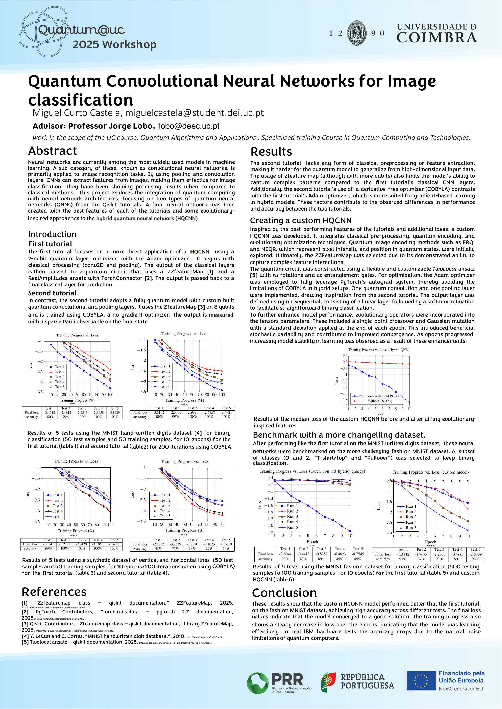](poster/poster_final.pdf)

The poster presented at the Quantum@UC 2025 Workshop, summarizing both tutorial
models, the custom HQCNN, and the MNIST and Fashion-MNIST benchmarks. Click through
for the full-resolution [`poster_final.pdf`](poster/poster_final.pdf).

## Main deliverables

| | Location |
|---|---|
| Paper (LaTeX source + final PDF) | [`paper/`](paper/), see [`report_final.pdf`](paper/report_final.pdf) |
| Poster (final + drafts) | [`poster/`](poster/), see [`poster_final.pdf`](poster/poster_final.pdf) |
| Source code | [`src/`](src/) |
| Reference literature | [`docs/references/`](docs/references/) |

## Repository layout

```
paper/        LaTeX source (report.tex, references.bib) and report_final.pdf
  drafts/     earlier report versions (initial, v2, v3)
poster/       poster_final.pdf  +  archive/ (earlier drafts)
src/          HQCNN implementation
  hybrid_qcnn.py          main hybrid CNN model
  torch_hybrid_qnn.py     TorchConnector / EstimatorQNN wiring
  frqi_neqr_encoding.py   FRQI & NEQR image encoders
  frqi_vs_neqr.py         comparison of the two encodings
  train_baseline.py       baseline training
  train_no_evolution.py   training without circuit evolution
  train_noise.py          training under a noise model
  run_real_hardware.py    run on real IBM Quantum hardware
  retrieve_jobs.py        retrieve results from submitted jobs
  hybrid_qcnn.ipynb       exploratory notebook
  models/                 saved checkpoints (*.pt)
  results/                generated figures
  sandbox/                Qiskit-tutorial follow-alongs (incl. qcnn_tutorial2.py), scratch scripts, notes
docs/references/          papers and project briefs cited in the report
coursework/               secondary course assignments (see below)
```

## Circuits and results

Figures generated by the code in `src/`, written to `src/results/`.

The building blocks of the fully quantum model, from the second Qiskit tutorial:

| Feature map | Convolutional unit | Pooling unit |
| ----------- | ------------------ | ------------ |
| 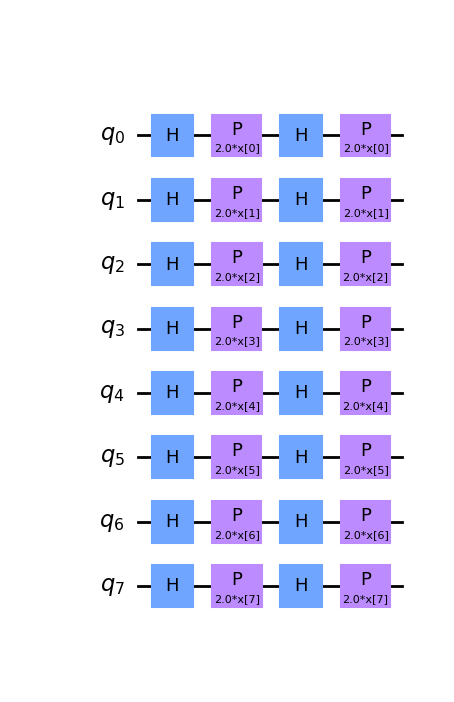 | 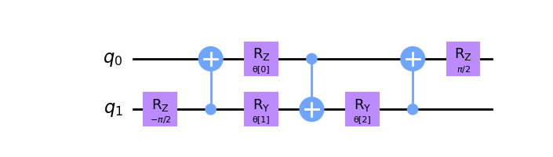 | 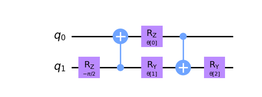 |

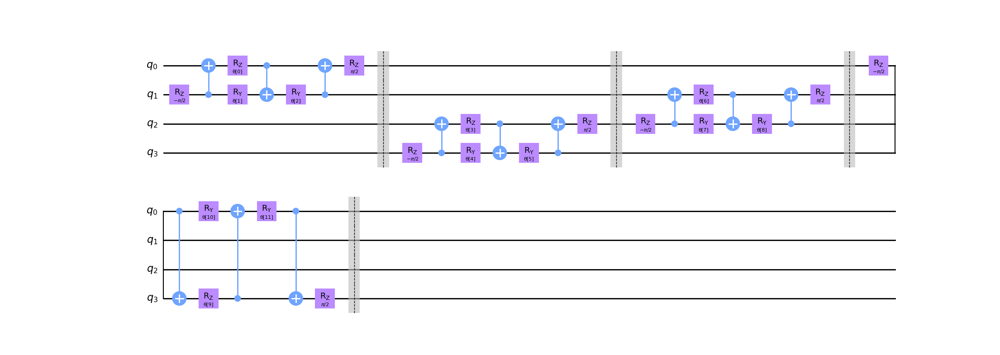

A convolutional layer is the two-qubit unit tiled across neighbouring qubit pairs;
pooling then discards half the qubits, so the circuit narrows the way a classical
CNN narrows its feature maps.


The complete circuit: feature map, then alternating convolutional and pooling layers
down to a single measured qubit.

| Training samples | Test predictions |
| ---------------- | ---------------- |
| 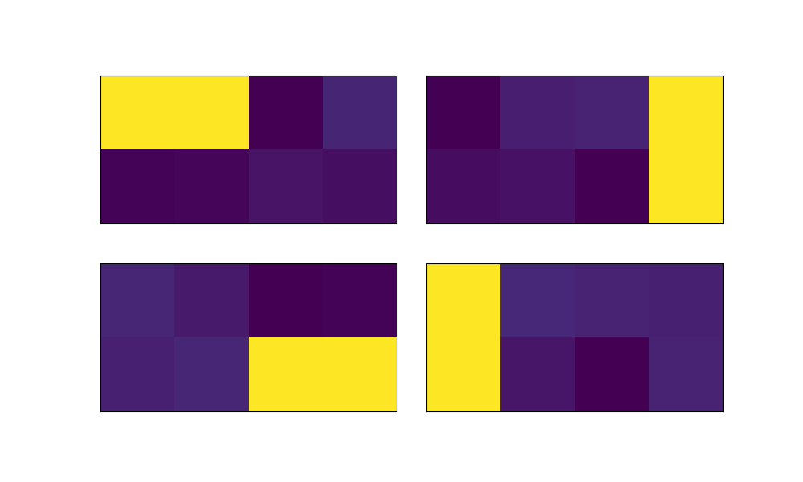 | 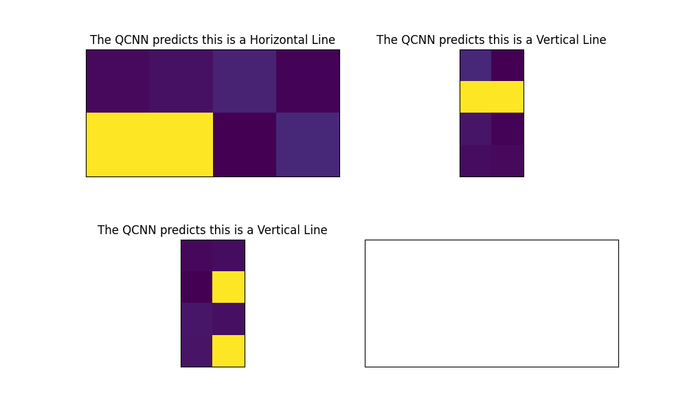 |

The first tutorial's hybrid model, and the effect of adding the evolutionary-inspired
operators described on the poster:

| Predictions | Loss per epoch |
| ----------- | -------------- |
| 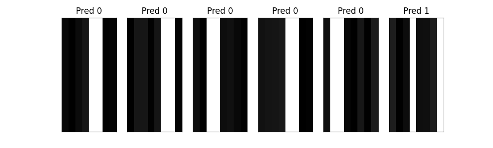 | 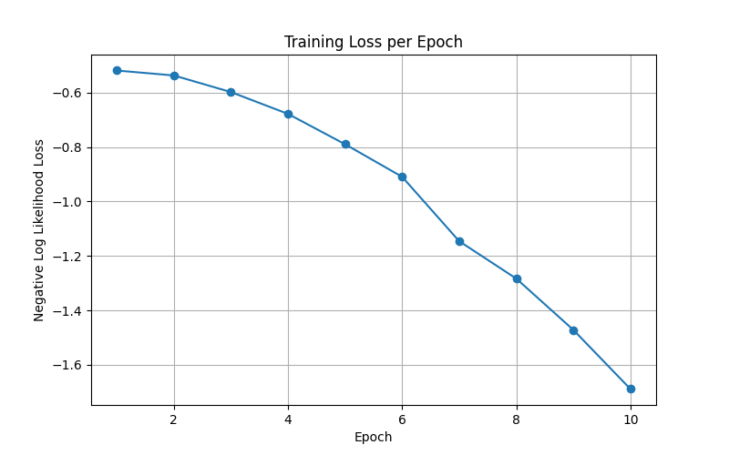 |

| With evolutionary operators | Without |
| --------------------------- | ------- |
| 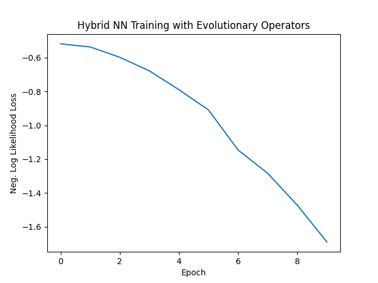 | 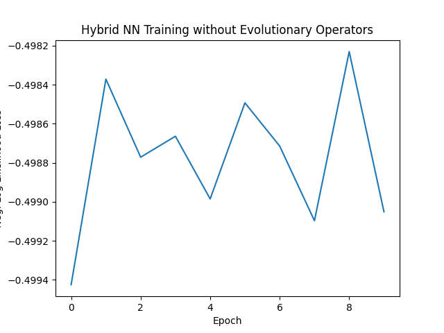 |

## Coursework (secondary)

Earlier assignments from the same course, kept for completeness:

- [`coursework/01-polarizers/`](coursework/01-polarizers/), photon polarization experiments
- [`coursework/02-deutsch-jozsa-grover/`](coursework/02-deutsch-jozsa-grover/), Deutsch-Jozsa and Grover implementations
- [`coursework/03-final-problem/`](coursework/03-final-problem/), final problem set
- [`coursework/tfm-project/`](coursework/tfm-project/), TFM project document

## Running the code

The code uses Qiskit, Qiskit Machine Learning, PyTorch, torchvision,
scikit-learn, scikit-image, NumPy and matplotlib.

```bash
python -m venv myenv && source myenv/bin/activate
pip install qiskit qiskit-machine-learning qiskit-ibm-runtime \
            torch torchvision scikit-learn scikit-image numpy matplotlib

python src/train_baseline.py
```

The MNIST / FashionMNIST datasets download automatically on first run into `data/`,
which is git-ignored.

### IBM Quantum credentials

`run_real_hardware.py` and `retrieve_jobs.py` need an IBM Quantum API token. Provide it
via a local `.env` file:

```
QISKIT_TOKEN=your_token_here
```

## Authors

- Miguel Castela (DEI, Universidade de Coimbra)

Supervised by Professor Jorge Lobo (ISR, Universidade de Coimbra).
